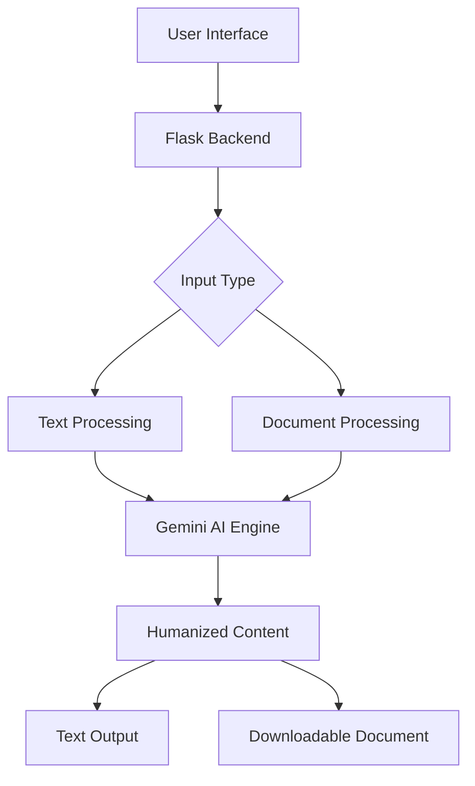

# AI Text & Document Humanizer

An AI-powered web application that transforms robotic and 
AI-generated text into natural, fluent, and readable content 
while preserving the original meaning and context.

Built using Python, Flask, and Google Gemini AI.

## Features

- AI-powered text humanization
- Natural and fluent sentence restructuring
- PDF, DOCX, and TXT document support
- Downloadable humanized documents
- Original document formatting preservation where possible
- Automatic Gemini AI model fallback
- Drag-and-drop document upload
- Real-time word counter
- Copy-to-clipboard functionality
- Responsive and user-friendly interface
- Secure API key management

## Humanization Modes

| Mode | Description |
|------|-------------|
| Natural | Natural and conversational writing |
| Academic | Clear and structured academic writing |
| Professional | Formal and polished communication |
| Casual | Friendly and informal writing |

## Technology Stack

### Frontend
- HTML5
- CSS3
- JavaScript

### Backend
- Python
- Flask
- Gunicorn

### Artificial Intelligence
- Google Gemini API
- Natural Language Processing
- Prompt Engineering
- Automatic Model Fallback

### Document Processing
- PyMuPDF
- Python-docx
- PyPDF

## System Architecture



## Project Structure

```text
AI_TEXT_HUMANIZER/
│
├── app.py
├── gemini_engine.py
├── document_processor.py
├── requirements.txt
├── .gitignore
├── README.md
│
├── static/
│   ├── style.css
│   └── script.js
│
└── templates/
    └── index.html
```

## Installation and Setup

### 1. Clone the repository

```bash
git clone https://github.com/Shivansh15-web/AI_TEXT_HUMANIZER.git
cd AI_TEXT_HUMANIZER
```

### 2. Create a virtual environment

```bash
python -m venv venv
```

### 3. Activate the virtual environment

Windows:

```bash
venv\Scripts\activate
```

Linux/macOS:

```bash
source venv/bin/activate
```

### 4. Install dependencies

```bash
pip install -r requirements.txt
```

### 5. Configure the Gemini API

Create a `.env` file in the root directory.

```env
GEMINI_API_KEY=your_api_key_here
GEMINI_MODEL=gemini-3.5-flash-lite
```

Use a Gemini model available to your API account.

Get your API key from:
https://aistudio.google.com/apikey

Never share or upload your API key publicly.

### 6. Run the application

```bash
python app.py
```

Open the application in your browser:

http://127.0.0.1:5000

## How It Works

1. The user enters text or uploads a document.
2. The user selects a preferred writing style.
3. The Flask backend processes the input.
4. Large text is divided into manageable batches.
5. Gemini AI rewrites the content.
6. The system reconstructs the document where applicable.
7. The user receives the humanized text or downloadable file.

## Key Innovations

- Multi-format document humanization.
- Formatting-aware document reconstruction.
- Automatic AI model switching during API failures.
- Batch processing for longer documents.
- Multiple customizable writing styles.
- Integrated text and document processing.

## Applications

- Content writing
- Professional communication
- Grammar and readability improvement
- Academic language editing
- Email writing
- Report editing
- Blog content refinement

## Current Limitations

- Maximum document upload size: 10 MB.
- Maximum text processing limit: 25,000 characters.
- Internet connection and Gemini API access are required.
- Scanned PDFs are not currently supported.
- Complex formatting may remain unchanged.
- Exact PDF formatting preservation is not guaranteed.
- AI-generated revisions should be reviewed for accuracy.

## Future Enhancements

- OCR support for scanned documents
- Multilingual humanization
- Sentence-level rewriting
- User authentication
- Document processing history
- Advanced readability analysis
- Side-by-side document comparison
- API rate limiting

## Developer

**Shivansh Mishra**

GitHub: [Shivansh15-web](https://github.com/Shivansh15-web)

## Disclaimer

This project is designed to improve writing quality, 
clarity, and readability. Users are responsible for 
reviewing generated content and following applicable 
academic and professional integrity guidelines.

---

If you find this project useful, consider giving 
the repository a star.
